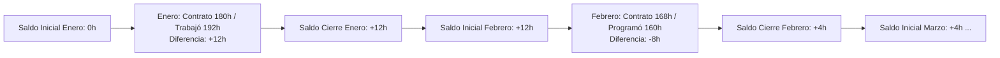

# 18. Modelo de Banco de Horas (Acumulación Continua)

## 1. Visión General del Modelo
En la operación hospitalaria continua (24/7/365), la cantidad de horas laboradas por el personal rara vez coincide con exactitud matemática con las horas pactadas en el contrato mensual. Debido a la longitud variable de los meses (28 a 31 días), la distribución de fines de semana y las necesidades imprevistas de cobertura asistencial, se producen desfases mensuales recurrentes.

Para gestionar esta realidad sin generar fricciones administrativas ni pagos desordenados de horas extras, **Rafa Turnos** incorpora el modelo de **Banco de Horas**:
- **Naturaleza Continua**: Las horas a favor o en contra se arrastran mes a mes de forma acumulativa y continua.
- **Sin Periodicidad de Caducidad**: **No existe fecha de corte, vencimiento ni reseteo periódico (ni semestral ni anual)**. El saldo acumulado permanece vivo a lo largo del tiempo hasta que sea compensado operativamente mediante la programación de turnos y descansos.
- **Desacoplamiento Financiero Estricto**: El banco de horas gestiona **exclusivamente volúmenes de tiempo físico (horas ordinarias)**, nunca valores monetarios en dinero ($).

---

## 2. Ecuación y Lógica de Arrastre Continuo

Al cierre mensual de cada cuadrante (estado `CERRADO_NOMINA`), el sistema ejecuta el balance contable de tiempo para cada colaborador:

$$\text{Saldo Mes Actual} = \text{Horas Reales Laboradas} - \text{Horas Contractuales del Mes}$$

$$\text{Saldo Final Acumulado} = \text{Saldo Inicial (Mes Anterior)} + \text{Saldo Mes Actual}$$

### Interpretación de los Estados de Saldo
* **Saldo $> 0$ (A favor del empleado)**: El colaborador laboró más horas de las contratadas. El hospital le adeuda tiempo libre compensatorio.
* **Saldo $< 0$ (En contra del empleado / A favor del hospital)**: El colaborador laboró menos horas de las requeridas contractualmente (por baja ocupación, ajustes de rotación o permisos). El colaborador adeuda turnos u horas al hospital.
* **Saldo $= 0$**: Balance neutro exacto.



---

## 3. Reglas de Negocio Específicas (CST Colombia)

| Código | Regla | Nivel | Comportamiento del Sistema |
|---|---|---|---|
| **RN-BH01** | **Separación de Recargos Económicos** | Obligatorio Legal | **El banco de horas acumula únicamente volumen de tiempo ordinario**. Si un turno genera recargos nocturnos (35%), dominicales/festivos (75%) o de horas extras según la ley colombiana, **el recargo económico debe reportarse y pagarse en la nómina del mes corriente**. No se retiene el recargo en el banco de horas bajo ninguna circunstancia. |
| **RN-BH02** | **Continuidad Permanente (Sin Caducidad)** | Parametrización | El saldo acumulado nunca vence al final del año calendario ni en ningún semestre. Se transfiere íntegramente al saldo inicial del mes siguiente ($S_{\text{inicial}}^{M+1} = S_{\text{final}}^{M}$). |
| **RN-BH03** | **Turno de Compensación en la Matriz (`COMP`)** | Operativo | Para amortizar horas a favor del colaborador, la supervisora asigna en el cuadrante la ficha o turno de descanso compensatorio **`COMP`** (o `L` con justificación). El sistema contabiliza las horas de jornada estándar (ej. 6h u 8h) descontándolas automáticamente del saldo acumulado a favor. |
| **RN-BH04** | **Priorización Heurística de Cobertura** | Asistido | En el asistente de balanceo y autocompletado de huecos del nuevo mes, el motor algorítmico prioriza proponer turnos a colaboradores que presenten **saldo negativo en contra**, ayudando a sanear su deuda de horas sin sobrecargar a quienes ya tienen horas a favor. |
| **RN-BH05** | **Semáforos de Alerta por Sobreacumulación** | Preventivo | Alerta visual en la matriz cuando un colaborador supera un umbral prudencial de acumulación (ej. más de $+30\text{h}$ a favor o más de $-20\text{h}$ en contra), facilitando la toma de decisiones por parte de Supervisión y Gestión Humana. |

---

## 4. Experiencia de Usuario (UX en Angular)

### A. Vista en el Planificador Mensual (Cuadrícula del Supervisor)
En el panel lateral o en la columna de totales por colaborador, se presenta la pastilla informativa de balance:

```text
[ Empleado: Diana Mora | Enf. Jefe ]
Contrato Mes: 168h  |  Programadas: 160h  |  Banco Ant: +12h  |  Balance Proyectado: +4h (Verde)
```

* **Color Verde**: Saldo en equilibrio o ligeramente positivo (0 a +15h).
* **Color Ámbar**: Saldo con horas a favor considerables (+16h a +30h) o deuda moderada (-1h a -15h).
* **Color Rojo**: Desbalance severo (> +30h a favor o < -20h en contra), sugiriendo intervención prioritaria de descansos o asignación de turnos.

### B. Vista en el Portal del Empleado
En su teléfono móvil o en la Intranet, el colaborador visualiza su widget de tiempo transparente:
* **"Mi Banco de Horas"**: Muestra el saldo neto acumulado actual con el desglose histórico mes a mes para total claridad y confianza en su liquidación horaria.

---

## 5. Impacto en el Reporte Consolidado para Nómina (Excel)

En la pestaña **"Resumen_Nomina"** del archivo Excel que Rafa Turnos entrega a Gestión Humana, se añaden las columnas de trazabilidad del banco de horas al final del desglose de conceptos:

| Documento | Colaborador | Servicio | ... | HOD | HON | HDFD | Saldo Anterior Banco | Saldo Mes Actual | Nuevo Saldo Acumulado |
|:---:|:---:|:---:|:---:|:---:|:---:|:---:|:---:|:---:|:---:|
| 1098765432 | Diana Mora | Urgencias | ... | 120 | 36 | 12 | **+12.0** | **-8.0** | **+4.0** |
| 1012345678 | Camilo López | Urgencias | ... | 96 | 48 | 24 | **-6.0** | **+10.0** | **+4.0** |

Esto permite a Gestión Humana auditar la evolución histórica del banco de horas y alimentar de forma transparente los sistemas de personal sin confusiones ni reclamos de fin de mes.
