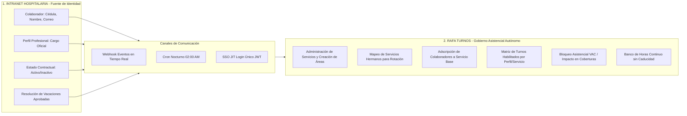

# 20. Arquitectura de Integración, Sincronización y Gobierno de Servicios

## 1. Visión y Principio Rector de Desacoplamiento
Para garantizar la máxima agilidad operativa sin dependencias burocráticas de sistemas externos, **Rafa Turnos** opera como un **servicio satélite autónomo especializado**.

La delimitación de responsabilidades entre la **Intranet Institucional** y **Rafa Turnos** se rige por un principio estricto:

> **La Intranet entrega la Identidad y el Perfil Profesional del Colaborador; Rafa Turnos gobierna la Organización Asistencial, los Servicios, las Coberturas y la Movilidad.**

---

## 2. Frontera de Responsabilidades

### A. Lo que Provee la Intranet (Datos Maestros)
1. **Identidad del Personal**: Cédula de ciudadanía, nombres, apellidos y correo institucional.
2. **Perfil Profesional Homologado**: El cargo oficial legal (ej. `Médico General`, `Médico Especialista`, `Enfermero(a) Jefe`, `Auxiliar de Enfermería`, `Bacteriólogo(a)`, `Conductor de Ambulancia`, etc.).
3. **Estado Contractual**: Indica si la persona continúa vinculada o si fue retirada.
4. **Novedades Legales Formales (Vacaciones y Licencias)**: Actos administrativos aprobados con fecha de inicio y fin. *(Rafa Turnos dispone adicionalmente de registro local de novedades como contingencia si la Intranet no expone API de ausencias)*.

### B. Lo que Administra Autónomamente Rafa Turnos
1. **Gobierno Total de Servicios Hospitalarios**:
   * Creación, edición y parametrización de servicios asistenciales (ej. *Urgencias Generales*, *Maternidad*, *Cirugía / Quirófanos*, *Farmacia 24/7*, *Facturación Urgencias*, etc.).
   * Creación ágil de servicios temporales o de contingencia (ej. *Expansión Respiratoria* o *Cuidado Crítico COVID*) sin necesidad de alterar la estructura jerárquica de la Intranet.
2. **Definición de "Servicios Hermanos" (Afinidad y Flujo)**:
   * Enlace bidireccional entre servicios que comparten complejidad clínica y bioseguridad (ej. *Urgencias* $\longleftrightarrow$ *Maternidad* $\longleftrightarrow$ *Pediatría*).
   * Los colaboradores solo pueden rotar o prestarse entre servicios previamente enlazados como **hermanos** y siempre que mantengan **idéntico perfil profesional**.
3. **Adscripción del Personal a un Servicio Base**:
   * Rafa Turnos asigna a cada colaborador su servicio de radicación principal y habilita su disponibilidad para los servicios hermanos enlazados.
4. **Matriz de Turnos Habilitados por Perfil y Servicio**:
   * Parametrización de qué turnos del catálogo aplican a cada cargo dentro de cada servicio (ej. Médicos en Urgencias pueden realizar `G24` o `D12`; Auxiliares tienen restringido `G24` por salud ocupacional y solo operan en turnos de 8h como `M8`, `T8`, `N8`).
5. **Ratios y Coberturas Mínimas**:
   * Definición de dotación requerida por servicio, turno y categoría profesional.

---

## 3. Estrategia de Sincronización Multi-Mecanismo

Para garantizar que la información fluya sin fricción humana ni inconsistencias, se implementan tres mecanismos coordinados:

| Mecanismo | Disparador | Frecuencia / Momento | Propósito |
|---|---|---|---|
| **Mecanismo 1: Webhooks en Tiempo Real (Canal Primario)** | Evento en la Intranet (`empleado.creado`, `empleado.actualizado`, `vacaciones.aprobadas`) | Inmediato (segundos) | Mantiene el sistema actualizado en vivo. Si Talento Humano aprueba vacaciones a un colaborador, las celdas se bloquean con `VAC` al instante. |
| **Mecanismo 2: Cron Job Nocturno de Conciliación** | Reloj interno del backend NestJS | Diario a las 02:00 AM | Reconcilia masivamente la base de datos completa durante la ventana de menor tráfico hospitalario, recuperando eventos que pudieran haberse omitido. |
| **Mecanismo 3: Sincronización JIT en el Login (SSO JWT)** | Clic del colaborador en "Gestión de Turnos" desde la Intranet | Al vuelo (on-login) | Verifica la firma del token JWT y actualiza los datos del usuario si es su primer ingreso o si cambió de correo/cargo. |
| **Mecanismo de Contingencia: Botón Técnico Administrativo** | Clic humano autorizado por `SUPERADMIN` o `GESTION_HUMANA` | Excepcional / Manual | Permite forzar una sincronización manual completa tras cortes eléctricos, caídas de red o durante el despliegue del "Día Cero". |

---

## 4. Gestión del Ciclo de Vacaciones e Incapacidades

1. **Recepción del Evento**:
   * La Intranet notifica un rango de vacaciones aprobado para un colaborador (ej. `2026-12-01` a `2026-12-15`).
2. **Impacto en el Cuadrante (Rafa Turnos)**:
   * **Bloqueo Visual Estricto**: Las celdas de ese rango se asignan con la ficha **`VAC`** (color verde esmeralda) con indicador de candado.
   * **Inmunidad al Planificador**: El sistema bloquea el arrastre de cualquier turno de trabajo ordinario sobre esas fechas.
3. **Impacto en Coberturas y Banco de Horas**:
   * El pie de cuadrante refleja inmediatamente el déficit asistencial (alerta roja de vacante) para que la supervisora asigne un reemplazo o active rotación homóloga de un servicio hermano.
   * **Neutralidad en Banco de Horas**: Los días de vacaciones no causan deuda de horas en el Banco de Horas del colaborador.
